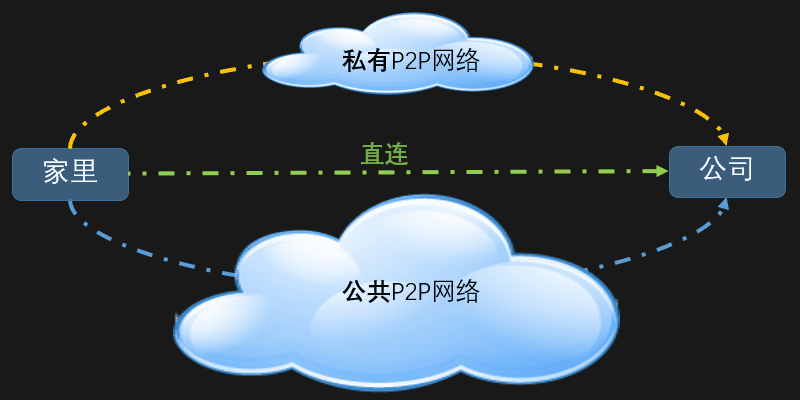

  

  
<strong>全网最简单、最快、 免费的内网穿透</strong>

  

          
          
        

        

          
          
          
        

  <!--h3><strong>【OSChina推荐项目】【CSDN孵化项目】</strong></h3-->

**************************************************************************************************************
外出办公, 对比市面上的远程工具, 无论画质、软件适配, 都不如 windows 自带的远程桌面, 但外出如何使用 windows远程桌面？

是否可以无需远程桌面, 直接访问公司的内网 WEB, GIT, SSH 等？
**************************************************************************************************************

**注: 从 v3.3.5 开始，Redis服务已切换到大厂云端，老版本将无法使用，请尽快升级**

**注: 仅用于学习研究, 无商业合作，更无恶意行为。如有广告之类盈利行为，会告知大家**

**注: windows 自带杀毒软件, 会将所有 go 语言写的程序都默认为病毒。本程序已开源, 放心食用**

**郑重声明：严禁用于违法行为！！！**

## 特点

### [>>>>>>> 点击查看使用教程 <<<<<<<](https://gitee.com/konyshe/goodlink/wikis/pages)

#### 对比FRP

| 维度 | frp | GoodLink |
| --- | --- | --- |
| 拓扑 | 必须有公网中继；业务流量几乎都走服务器 | 优先 P2P；信令（Redis）只交换地址 |
| 成本 | VPS 带宽/流量按量或套餐 | 直连成功后几乎不吃中继带宽；信令很轻 |
| 成功率 | 两端能连上服务器即可，与 NAT 类型关系弱 | 强依赖 NAT；NAT1–3 友好，双 NAT4 易失败 |
| 建立连接 | 通常很快、可预期 | 可能反复打洞、重试，文档常提数分钟量级 |
| 延迟/带宽 | 多一跳；上限受 VPS 出口限制 | 直连时延迟更低、更易跑满本地上行 |
| 隐私 | 中继可见流量元数据，甚至明文业务（取决于你是否再加密） | 直连后业务不经第三方；密钥配对 |
| 运维 | 自管 frps、证书、鉴权、限流、监控成熟 | 「一条命令」简单；复杂组网、多租户、审计较弱 |
| 失败兜底 | 中继在就能通 | 直连失败要靠中转/改 NAT/借友好 NAT 主机 |

#### 什么时候选谁

**更适合 frp**

- 要稳定、可预期（CI、生产运维、给非技术用户用）
- 两端常在对称 NAT / 运营商大内网 / 4G/5G
- 需要集中鉴权、多用户、HTTP 路由、域名、证书、限速等
- 能接受（或已有）一台公网 VPS，且流量成本可接受

**更适合 GoodLink**

- 偶尔远程回家/公司，追求「别为穿透长期买带宽」
- 至少一侧 NAT 较友好（桥接、UPnP、NAT1–2）
- 在意业务流量不经过第三方中继
- 场景简单：TUN / SOCKS5 / 少量端口转发就够

#### 一句话

- **frp**：用固定中继换「几乎总能通」
- **GoodLink**：用打洞换「通了就直连、省钱且更私密」

实务上很多人会 GoodLink 能打通就用，打不通就回退 frp/自建中继；两者不是互斥，而是可靠性和直连收益之间的选择。

## 💬 交流方式

- **GitHub Issues**：[提交问题和建议](https://github.com/konyshe/Goodlink/issues)
- **Gitee Issues**：[国内用户交流](https://gitee.com/konyshe/goodlink/issues)

## 🎯 贡献指南

- 🐛 发现Bug？请提交Issue
- 💡 有新想法？欢迎在Issues中讨论
- 🔧 想要贡献代码？请先fork项目并提交PR
- 📖 完善文档？欢迎提交文档改进建议

## 📄 许可证

本项目采用 MIT 许可证开源，详情请查看 [LICENSE](./LICENSE) 文件。

---

  
<strong>让内网访问变得简单安全！</strong>

  
Made with ❤️ by Goodlink Team

